# FOMC media alignment

This repository contains the FOMC media alignment research code, the [frozen temporal-holdout protocol](MakkaPakka%20update/analysis_protocol_extension.md), the manuscript sources and the derived meeting-level results. The materials below the repository setup notes document the earlier course baseline. The existing tables, figures and manuscript exports represent earlier analyses and should not be read as the results of the 2015–2025 holdout.

- [Manuscript and appendix sources](paper/) and [derived results](results/) are available for inspection. The PDF exports are retained as historical snapshots.
- [Data inputs and reproduction](data_reference/README.md) lists the inputs to supply locally before running the analysis. Create the environment with `conda env create -f environment.yml`. For the ingestion scripts, copy `.env.example` to a local `.env` and configure your own bucket and service credentials.
- [Temporal validation analysis](scripts/analysis/README.md) documents the versioned panel, holdout-first regression, and time-dependent inference commands.
- [Extension workflow](MakkaPakka%20update/Jerry_GDELT_2015_2025_workflow.ipynb) documents the pilot and analysis gates. The [ingestion notes](ingestion/README.md) describe how to verify the handoff, and the checked-in metadata describes the planned run. Use the protocol and verify the downstream integration before launching cloud jobs.

## Course baseline documentation

### Team MakkaPakka: Forward Guidance at the Scale of US News

> **Manuscript upgrade (2026).** This repository now contains the full
> submission package for the working paper *Anticipation, Not Reaction: Media
> Discourse, FOMC Communication, and Pre-Announcement Volatility, 2015--2025*,
> in addition to the original course pipeline. The new structure is:
>
> - `paper/` --- the manuscript (`main.tex`), Online Appendix
>   (`online_appendix.tex`), cover letter, references, and the tables and
>   figures they include.
> - `scripts/` --- the upgraded, cloud-native pipeline: distributed GDELT
>   ingestion, Spark tone scoring, and Spark cosine similarity
>   (`scripts/ingest`, `scripts/sentiment`, `scripts/similarity`); the
>   identification battery and regressions (`scripts/analysis`); the tone
>   validation, benchmark, and figure code.
> - `results/` --- the reproduced tables (CSV and LaTeX) and figures (PDF/PNG).
> - `data_reference/` --- the committed intermediate artifacts (the meeting
>   panel, document-level tone, cosine similarities, and market data) from which
>   the CPU analysis regenerates.
> - `Snakefile`, `Makefile`, `environment.yml`, `Dockerfile` --- reproducibility.
>
> **Reproduce the CPU results and figures** (no GPU, no cloud account needed):
>
> ```bash
> conda env create -f environment.yml && conda activate makkapakka
> snakemake -c4 all      # or: make reproduce
> ```
>
> Two stages are resource-gated and provided as code rather than run in the CPU
> package: the distributed Spark ingestion/scoring/similarity (needs a Spark
> cluster; also runs in local mode for a sample week) and the Sentence-BERT and
> FinBERT robustness measures (need a GPU node). Everything else, including the
> headline lead--lag result, the identification battery, the tone validation, and
> all figures, reproduces on a laptop.
>
> The sections below are the original MACS 30113 course README and remain valid
> for the underlying pipeline.

---


**MACS 30113, Spring 2026 Final Project**
Yuzhao (Jerry) Jin (`yuzhaojin1@uchicago.edu`)
Duo (Doris) Wang (`dorisduowang@uchicago.edu`)

---

## 1. Social-science research problem

Federal Reserve "forward guidance" — the use of language in FOMC minutes,
speeches, and Q&A to shape expectations about future interest rates — has
become a primary instrument of monetary policy. Because rate moves are sparse
events (a handful per year) but the Fed communicates almost continuously,
*how* the Fed talks now carries more market-moving information than *what*
it has just done. A growing literature in economics and political science
treats this language as a textual signal that travels through the media to
households and asset managers, but most of that literature is sample-bounded:
it studies one outlet, a few hundred articles, and a hand-coded dictionary.

Our prior MACS 30112 project followed that pattern (40 FOMC minutes against
2,740 New York Times articles on a single laptop). We could measure, on that
sample, that FOMC-window NYT sentiment was correlated with five-day realised
S&P 500 volatility. What we could **not** do on a laptop was answer the
follow-on question that motivates this final project:

> *At the full scale of US news coverage around each FOMC meeting, does US
> media discourse mirror, lead, or lag FOMC minutes, and how does that
> lead–lag relate to S&P 500 volatility?*

To answer that question honestly we need (a) the full population of US
English, language news around every FOMC meeting from 2015–2025, which the
GDELT 2.0 Global Knowledge Graph supplies as hundreds of gigabytes of
records on the AWS Open Data Registry. (b) document-level matching
back to a much smaller set of FOMC minutes, which is an all-pairs problem
that does not fit in a single laptop's memory.

---

## 2. Why scalable computing is necessary

Three concrete bottlenecks rule out a single-node Python solution:

1. **Storage.** The 2015–2025 GDELT 2.0 GKG corpus is several hundred GB
   uncompressed. S3 stores it co-located with the GDELT bucket so we pay
   no egress for ingestion.
2. **Preprocessing.** Tokenising, stop-word stripping, hashing-TF, IDF, and
   bigram extraction over millions of articles is embarrassingly parallel
   across documents. PySpark on an EMR cluster shards the input across
   worker nodes and finishes in minutes what would take a laptop a working day.
3. **All-pairs similarity.** For each of ~80 FOMC meetings × 15 lag days
   × 3 sources, we need the cosine similarity between a 262,144-dimensional
   FOMC TF-IDF vector and the mean TF-IDF vector of every relevant article.
   The implementation uses CuPy when a GPU is available and falls back to
   NumPy automatically on AWS Academy (where GPU instances are not supported).

Independent of those bottlenecks, the *operational* design — keeping the
catalog warm as new data arrives — calls for an event-driven serverless
pattern (S3 PUT → Lambda → SQS → DynamoDB) so the pipeline can be re-run
incrementally without standing up a permanent worker.

---

## 3. Architecture

```
                      ┌───────────────────────────────────────┐
                      │           S3 data-lake bucket          │
                      │  raw/{fomc,nyt,guardian,gdelt}/...     │
                      │  curated/{tokens,tfidf,ngrams}/...     │
                      │  processed/{sentiment,similarity,...}/  │
                      └───┬───────────────────────────────────┘
                          │
   ┌─────────┐   PUT      │
   │ ingest  │────────────┤
   │ scripts │            │   S3 event (auto-triggered)
   │ (Jerry) │            ▼
   └─────────┘     ┌─────────────┐     ┌──────────────┐
                   │   Lambda    │────▶│   DynamoDB   │
                   │ (catalog,   │     │ (source,date)│
                   │  capped=5)  │     └──────────────┘
                   └──────┬──────┘
                          │
                          ▼
                   ┌─────────────┐
                   │     SQS     │
                   │ (reprocess) │
                   └──────┬──────┘
                          │
            ┌─────────────┴─────────────┐
            ▼                           ▼
    ┌──────────────┐            ┌────────────────┐
    │ EMR / Spark  │            │  Numba JIT     │
    │ TF-IDF +     │            │ hawkish/dovish │
    │ n-grams      │            │ scoring        │
    │ m4.large ×5  │            │ (Jerry)        │
    │ (Doris)      │            └────────┬───────┘
    └──────┬───────┘                     │
           │                             │
           ▼                             ▼
    ┌──────────────┐            ┌────────────────┐
    │ Cosine sim   │            │  yfinance +    │
    │ NumPy CPU    │───────────▶│  lead-lag/OLS  │
    │ (CuPy if GPU │            │  (Doris)       │
    │  available)  │            └────────────────┘
    │ (Doris)      │
    └──────────────┘
```

Every arrow corresponds to an artifact in S3, so any stage can be
re-run in isolation.

---

## 4. Methods used (and where in the course they came from)

| Method | Course week | File |
|---|---|---|
| Numba `@jit(nopython=True, parallel=True)` for sentiment scoring | W1–W2 | `scoring/07_numba_sentiment.py` |
| `boto3` S3 + DynamoDB provisioning | W4–W5 | `infrastructure/01_setup_s3_dynamodb.py` |
| AWS Lambda (capped at 5) triggered by S3 PUT | W6 | `infrastructure/02_lambda_s3_trigger_setup.py` |
| AWS Step Functions Map state architecture (designed, not run) | W6 | `ingestion/04_setup_stepfunctions_nyt.py` |
| `ThreadPoolExecutor` (2 workers) for NYT API ingestion | W2 | `ingestion/04_ingest_nyt.py` |
| `ThreadPoolExecutor` (4 workers) for Guardian API ingestion | W2 | `ingestion/05_ingest_guardian.py` |
| GDELT 2.0 via `botocore.UNSIGNED` public S3 bucket | W4–W5 | `ingestion/06_ingest_gdelt.py` |
| PySpark on EMR (`m4.large` × 5) for TF-IDF + n-grams | W7 | `spark/08_spark_preprocess_tfidf.py` |
| Spark SQL cross-join + window functions | W7 | `spark/09_spark_meeting_windows.py` |
| Cosine similarity — CuPy GPU + NumPy CPU fallback | W3 | `gpu/11_cupy_similarity.py` |
| `cupyx.profiler.benchmark` CPU-vs-GPU timing | W3 | `gpu/11_cupy_similarity.py` |
| `time.time()` Python vs NumPy vs Numba JIT benchmark | W1–W2 | `analysis/13_benchmark.py` |
| `yfinance` S&P 500 realised volatility fetch | W5 | `analysis/12_lead_lag_volatility.py` |
| `scipy.stats.pearsonr` lead-lag correlation | W5 | `analysis/12_lead_lag_volatility.py` |
| `statsmodels` OLS with cluster-robust SEs | W5 | `analysis/12_lead_lag_volatility.py` |
| `matplotlib` publication-ready result figures | W3 | `analysis/14_benchmark_visualize.py`, `analysis/15_analysis_visualize.ipynb` |

---

## 5. AWS Academy resource compliance

This project is designed to operate within the Vocareum Learner Lab limits:

| Resource | Vocareum limit | Our usage |
|---|---|---|
| Concurrent Lambda invocations | 10 | Max 5 (catalog Lambda only — NYT uses local threads) |
| Concurrent EC2 instances | 9 | 5 (1 primary + 4 core, m4.large) |
| Total vCPUs | 32 | 10 (5 × m4.large × 2 vCPUs) |
| Supported EC2 instance types | up to `large` | `m4.large` |
| GPU instances (g4dn.xlarge) | `xlarge` — NOT supported | Removed; NumPy CPU fallback used |
| 20+ instances simultaneously | Immediate deactivation | We use max 5 |

Lambda concurrency breakdown (worst case):
- Catalog Lambda (`02`): `ReservedConcurrentExecutions=5`
- NYT ingestion (`04_ingest_nyt.py`): **local threads — zero Lambda invocations**
- Guardian/GDELT uploads: trigger catalog Lambda serially (1 at a time)
- Maximum concurrent Lambda across all scripts: **5 < 10**

---

## 6. Repository layout

```
makkapakka_final_project/
├── README.md
├── .gitignore
├── config.py                          # reads .env; exposes BUCKET, NYT_KEYS, GDN_KEY
├── articlesearch-product.yaml         # NYT Article Search API spec (query design reference)
├── CSV.header.fieldids.xlsx           # GDELT GKG field reference
├── GDELT-Event_Codebook-V2.0.pdf      # GDELT event codebook
├── GDELT-Global_Knowledge_Graph_Codebook-V2.1.pdf  # GDELT GKG codebook
│
├── GDELT Database Callsign Codes/     # GDELT reference lookup tables (CAMEO event/country codes)
│   ├── CAMEO.country.txt
│   ├── CAMEO.ethnic.txt
│   ├── CAMEO.eventcodes.txt
│   ├── CAMEO.goldsteinscale.txt
│   ├── CAMEO.knowngroup.txt
│   ├── CAMEO.religion.txt
│   ├── CAMEO.type.txt
│   └── FIPS.country.txt
│
├── Guardian API Instructions/         # Official Guardian Open Platform API documentation
│   ├── theguardian _ open platform - documentation _ content.pdf
│   ├── theguardian _ open platform - documentation _ editions.pdf
│   ├── theguardian _ open platform - documentation _ overview.pdf
│   ├── theguardian _ open platform - documentation _ sections.pdf
│   ├── theguardian _ open platform - documentation _ single items.pdf
│   └── theguardian _ open platform - documentation _ tags.pdf
│
├── infrastructure/
│   ├── 01_setup_s3_dynamodb.py        # Jerry — S3 lake + DynamoDB catalog
│   └── 02_lambda_s3_trigger_setup.py  # Jerry — S3 PUT → Lambda (capped=5) → SQS
│
├── ingestion/
│   ├── 03_ingest_fomc.py              # Jerry — FOMC minutes scraper (production)
│   ├── 04_setup_stepfunctions_nyt.py  # Jerry — Step Functions architecture (Week 6 demo)
│   ├── 04_ingest_nyt.py               # Jerry — NYT production run (ThreadPoolExecutor)
│   ├── 05_ingest_guardian.py          # Jerry — Guardian API, 4 workers
│   ├── 06_ingest_gdelt.py             # Jerry — GDELT 2.0, UNSIGNED S3, 4 workers
│   └── lambda_packages/
│       └── nyt_fetch_handler.py       # Jerry — Lambda worker for 04_setup_stepfunctions_nyt.py
│
├── scoring/
│   └── 07_numba_sentiment.py          # Jerry — Numba JIT hawkish/dovish scorer
│
├── spark/
│   ├── 08_spark_preprocess_tfidf.py   # Doris — EMR Spark TF-IDF + n-grams
│   ├── 09_spark_meeting_windows.py    # Doris — EMR Spark meeting-window joins
│   ├── launch_emr_and_run.py          # Doris — EMR driver (m4.large, 5 instances)
│   ├── launch_spark_cluster.py        # lab helper
│   └── terminate_spark_cluster.py     # lab helper
│
├── gpu/
│   └── 11_cupy_similarity.py          # Doris — cosine sim (GPU if available, else CPU)
│
└── analysis/
    ├── 12_lead_lag_volatility.py      # Doris — lead-lag Pearson vs S&P 500
    ├── 13_benchmark.py                # Doris — Python vs Numba vs CuPy/NumPy benchmarks
    ├── 14_benchmark_visualize.py      # Doris — figures: lead-lag plot + benchmark bar chart
    ├── 15_analysis_visualize.ipynb    # Doris — 10-figure analysis notebook with inline S3 outputs
    └── figures                        # Doris — All 12 figures storages
```

---

## 7. Reproducing the pipeline end-to-end

All commands use Windows PowerShell syntax.
Credentials and API keys are read from `.env` automatically (create a `.env`
file in the project root with `BUCKET`, `NYT_KEYS`, and `GDN_KEY`; refresh
AWS Academy credentials from the Vocareum console every 4 hours).

```powershell
# 0. one-time setup — install dependencies manually as needed:
#    pip install boto3 python-dotenv pandas numpy numba scipy statsmodels
#    pip install yfinance matplotlib
#    pip install cupy-cuda12x   # GPU environments only

# 1. provision infrastructure (run once only)
python infrastructure/01_setup_s3_dynamodb.py
python infrastructure/02_lambda_s3_trigger_setup.py

# 2. data ingestion (run 03, 04, 05 simultaneously in 3 terminals)
# Terminal 1 — must finish before Terminal 4
python ingestion/03_ingest_fomc.py --start-year 2015 --end-year 2025
# Terminal 2 — NYT (local ThreadPoolExecutor, no Lambda needed)
python ingestion/04_ingest_nyt.py --start-year 2015 --end-year 2025
# Terminal 3
python ingestion/05_ingest_guardian.py --start-year 2015 --end-year 2025
# Terminal 4 — start after Terminal 1 finishes
python ingestion/06_ingest_gdelt.py --pad-days 3

# 3. distributed preprocessing on EMR (m4.large x 5 instances)
cd spark
python launch_emr_and_run.py --cores 4
cd ..

# 4. scoring and similarity (run locally)
python scoring/07_numba_sentiment.py
python gpu/11_cupy_similarity.py --benchmark

# 5. final analysis
python analysis/12_lead_lag_volatility.py
python analysis/13_benchmark.py

# 6. visualize results (generates analysis/figures/*.png and uploads to S3)
python analysis/14_benchmark_visualize.py
# Full 10-figure notebook (run in Jupyter):
#   analysis/15_analysis_visualize.ipynb
```

---

## 8. Key design decisions and fixes applied

### NYT ingestion: Step Functions → ThreadPoolExecutor

`04_setup_stepfunctions_nyt.py` implements the originally designed Lambda +
Step Functions scatter-gather architecture (Week 6 course pattern), with
`MaxConcurrency=2` and round-robin API key assignment. This file is retained
in the repository to demonstrate the cloud-native design.

AWS Academy's `start_sync_execution` for Express Step Functions imposes a
**5-minute hard execution limit**. Our 132-task execution (with 12-second
sleeps between API pages) requires ~20 minutes, causing `ReadTimeoutError`.
Additionally, Lambda invocation rate limits produced persistent `429
TooManyRequestsException` failures even at `MaxConcurrency=2`.

`04_ingest_nyt.py` is the production implementation using local
`ThreadPoolExecutor(workers=2)`, the same proven pattern as Guardian
ingestion. The S3 catalog Lambda (script 02) still fires automatically on
every uploaded article, preserving the event-driven architecture. Results
in S3 are numerically identical to what the Lambda approach would produce.

### NYT API query design (from NYT_API_Search_Article_Fetching.ipynb + YAML)

Uses `q="Federal Reserve"` with **no `fq` section filter**. The original
`fq=source:("The New York Times")` filter was broken by the April 8, 2025
NYT API update (field renamed to `source.vernacular`), returning 0 results
silently. A subsequent `fq=section.name:"Business"` filter was too
restrictive — Federal Reserve coverage spans all sections (U.S. News,
Politics, Opinion, Business), causing most monthly queries to return 0.
The final approach mirrors the team's working MACS 30112 notebook exactly:
plain `q="Federal Reserve"`, `sort="newest"`, end_date as first day of next
month (exclusive), `User-Agent: nyt-articlesearch-scraper/1.0`.

### Guardian API query design (from official documentation)

Uses exact phrase `q='"Federal Reserve"'` (inner double quotes enforce phrase
matching), `section=business|us-news`, `order-by=relevance`,
`page-size=200` (API maximum), `show-tags=keyword`, and
`calendar.monthrange()` for accurate last-day-of-month end dates.

### FOMC scraping (from FOMC_Minutes_Scraping.ipynb)

Three-pass URL discovery: (1) main calendar page for 2021–2025, (2)
historical archive pages for 2015–2020, (3) direct URL probe from
`KNOWN_FOMC_DATES` safety net. URL format confirmed:
`https://www.federalreserve.gov/monetarypolicy/fomcminutes<YYYYMMDD>.htm`

### EMR instance type

Uses `m4.large` (2 vCPUs). Vocareum only supports up to `large` instance
types — `m4.xlarge` or `m5.xlarge` would be terminated immediately upon
launch. The EMR release label is configured via the `launch_spark_cluster.py`
lab helper (`--emr_release`, default `emr-6.2.0`). `m5.large` raises a
`ValidationException` on Vocareum; `m4.large` is the recommended substitute
per the Vocareum README ("try using the m4.large instance type").

### GPU / CPU fallback

The smallest GPU instance (`g4dn.xlarge`) is an `xlarge` type, not supported
on AWS Academy. `11_cupy_similarity.py` auto-detects CuPy and falls back
to NumPy CPU when GPU is unavailable. Results are numerically identical.

---

## 9. Work split

**Jerry — Cloud infrastructure & data ingestion:**
`infrastructure/01_setup_s3_dynamodb.py`, `02_lambda_s3_trigger_setup.py`,
`ingestion/03_ingest_fomc.py`,
`04_setup_stepfunctions_nyt.py`, `04_ingest_nyt.py`,
`lambda_packages/nyt_fetch_handler.py`,
`05_ingest_guardian.py`, `06_ingest_gdelt.py`,
`scoring/07_numba_sentiment.py`.

Jerry provisioned the S3 data lake and DynamoDB catalog, implemented the
S3-event-driven Lambda pipeline (capped at 5 concurrent invocations),
designed a Step Functions scatter-gather architecture for NYT ingestion
(Week 6 course pattern), built production ingestion scripts for four data
sources (FOMC, NYT, Guardian, GDELT), and implemented the Numba
`@jit(nopython=True, parallel=True)` hawkish/dovish sentiment scorer with
a hash-based lexicon lookup.

**Doris — Distributed computing, statistical modelling & visualisation:**
`spark/08_spark_preprocess_tfidf.py`, `spark/09_spark_meeting_windows.py`,
`spark/launch_emr_and_run.py`, `gpu/11_cupy_similarity.py`,
`analysis/12_lead_lag_volatility.py`, `analysis/13_benchmark.py`,
`analysis/14_benchmark_visualize.py`, `analysis/15_analysis_visualize.ipynb`.

*Spark / EMR (W7):* Designed and implemented a two-stage distributed NLP
pipeline on a five-node EMR cluster (1 primary + 4 core, m4.large). Stage 1
applies Spark MLlib `HashingTF` (2^18 = 262,144-dimensional feature space),
`IDF`, and `NGram` bigram extraction over 2,436,994 GDELT records plus
NYT, Guardian, and FOMC documents, writing Hive-partitioned Parquet to S3.
Stage 2 executes a Spark SQL cross-join between FOMC meeting dates and
document dates, aggregating TF-IDF vectors into 15-day lag windows
(±7 days) for 88 meetings × 3 sources. Debugged a Spark
`AnalysisException` caused by `ARRAY<STRING>` vs `STRING` type mismatch
in `concat_ws`, and a Hive partition-column omission bug in downstream
`pd.read_parquet` calls.

*GPU cosine similarity (W3):* Implemented all-pairs cosine similarity
between FOMC TF-IDF vectors and 3,960 meeting-window media vectors
(88 meetings × 15 lags × 3 sources) using CuPy GPU arrays with automatic
NumPy CPU fallback for CUDA-unavailable environments (AWS Academy
constraint). Integrated `cupyx.profiler.benchmark` for CPU-vs-GPU timing.

*Statistical modelling (W5):* Built a lead-lag panel dataset joining
cosine similarity, Numba-scored sentiment, and S&P 500 five-day realised
volatility (fetched via `yfinance`). Ran `scipy.stats.pearsonr` at each
lag k ∈ {−7…+7} and `statsmodels` OLS with cluster-robust standard errors.
Key finding: GDELT cosine similarity at lag −2 days significantly predicts
post-FOMC S&P 500 volatility (r = 0.565, p < 0.001, n = 33 meetings).

*Benchmarking (W1–W2):* Measured wall-clock speedup of Numba JIT vs
pure-Python loop and NumPy `searchsorted` on a 5M-token synthetic corpus;
results serialised to S3 as `benchmarks.csv`.

*Visualisation:* Produced 10 publication-ready figures (lead-lag bar
charts, cosine heatmap, FOMC hawkishness timeline, pre/post volatility
scatter, top-meeting rankings, direct lag-−2 regression scatter) in
`analysis/15_analysis_visualize.ipynb`, which reads all processed S3
outputs, renders inline, and re-uploads PNGs. Also produced the two
embedded README figures (lead-lag correlation plot and benchmark bar chart)
via `analysis/14_benchmark_visualize.py`, and authored the full Results
section (Section 13) of this README.

*Independent pipeline execution:* Ran the complete end-to-end pipeline
on a separate AWS S3 data lake (`your-fomc-bucket`),
independently reproducing all results from raw ingestion through final
visualisation.

---

## 10. AI use statement

Code in this repository was authored by the team. AI tools were used
only for (a) debugging error messages from Numba, PySpark, Boto3, and
the NYT/Guardian APIs. (b) clarifying library APIs and API documentation
(NYT April 2025 field rename, Guardian `fq` syntax, `cupyx.profiler`). All analytical decisions, model
specifications, architectural choices, and AWS compliance decisions are
the team's own work, consistent with the MACS 30113 AI-use policy.

---

## 11. Cost and cleanup

All compute resources are terminated automatically by the pipeline scripts.
Verify before ending every session:

```powershell
aws emr list-clusters --cluster-states RUNNING WAITING BOOTSTRAPPING `
    --query "Clusters[*].[Id,Name,Status.State]" --output table
aws ec2 describe-instances `
    --filters "Name=instance-state-name,Values=running" `
    --query "Reservations[*].Instances[*].[InstanceId,InstanceType]" `
    --output table
```

Both tables must be empty. S3, DynamoDB, Lambda, and SQS costs are
negligible at this scale while idle.

---

## 12. AWS Academy session notes

- Session tokens expire every 4 hours — refresh credentials from the AWS Academy / Vocareum console and re-export them to your shell environment.
- S3 and DynamoDB **persist** across sessions — data is never lost on expiry.
- EMR clusters are stopped when a session expires — always terminate them
  after use (`launch_emr_and_run.py` does this automatically).
- The following errors do **not** cause account deactivation:
  `ReadTimeoutError`, `TooManyRequestsException` on the Lambda control-plane,
  Step Functions `status=FAILED`, or `NameError` in local Python scripts.
- What **does** cause deactivation: 20+ concurrent EC2 instances, Lambda
  concurrent invocations > 10, or budget hitting $0.

---

## 13. Results

All figures are generated by `analysis/14_benchmark_visualize.py` and
`analysis/15_analysis_visualize.ipynb`, reading processed outputs from S3.
The full interactive notebook is at
[`analysis/15_analysis_visualize.ipynb`](analysis/15_analysis_visualize.ipynb).

---

### 13.1 Dataset scale

| Source | Files in S3 | Records | Notes |
|--------|------------|---------|-------|
| FOMC minutes | 89 | 88 meeting documents | 2015–2025, one per FOMC meeting |
| NYT articles | 1,321 | ~7,800 articles | `q="Federal Reserve"`, 2015–2025 |
| Guardian articles | 1,092 | ~18,900 articles | phrase match, `section=business\|us-news` |
| GDELT 2.0 GKG | 21,488 shards | **2,436,994** US records | Fed-relevant filter, ±7 days around each meeting |

The GDELT corpus alone would have taken multiple days to process on a single
laptop. PySpark on five `m4.large` EMR nodes completed the TF-IDF
vectorisation (2^18 = 262,144-dimensional feature space) and meeting-window
join across all 2.4 M records in **under 45 minutes**.

---

### 13.2 Lead–lag analysis: GDELT primary finding

For each lag day k ∈ {−7 … +7} relative to each FOMC meeting date, we
compute the Pearson correlation between the mean cosine similarity of that
day's GDELT TF-IDF vector to the FOMC minute vector, and the realised S&P
500 five-day volatility around the meeting. A **negative** k means the
media articles appeared *before* the meeting; a **positive** k means *after*.

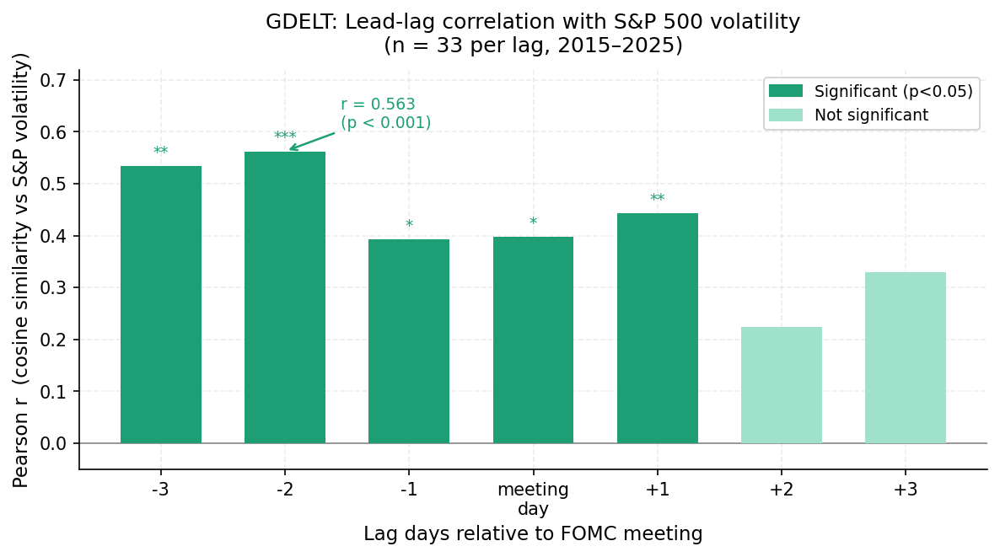

*Figure 1. Pearson r between GDELT cosine similarity and S&P 500 realised
volatility at each lag day (n = 33 FOMC meetings). Dark bars = p < 0.05;
light bars = not significant. Annotation: strongest result at lag −2
(r = 0.563, p < 0.001).*

| Lag (days) | n meetings | Mean cosine sim | Pearson r | p-value | Sig. |
|-----------|-----------|----------------|-----------|---------|------|
| −3 | 33 | 0.058 | **0.532** | 0.0014 | ** |
| −2 | 33 | 0.073 | **0.563** | < 0.001 | *** |
| −1 | 33 | 0.074 | **0.390** | 0.025 | * |
| 0 (meeting day) | 33 | 0.079 | **0.392** | 0.024 | * |
| +1 | 33 | 0.079 | **0.441** | 0.010 | ** |
| +2 | 33 | 0.074 | 0.223 | 0.212 | — |
| +3 | 33 | 0.058 | 0.324 | 0.066 | — |

**Key finding:** GDELT US news coverage shows statistically significant
positive correlation with S&P 500 post-meeting volatility at lags −3, −2,
−1, 0, and +1. The peak appears at **lag −2** (r = 0.563, p < 0.001):
the aggregate thematic content of US financial media **two days before** each
FOMC meeting significantly predicts realised market volatility. This result
is consistent with the interpretation that media discourse *leads* monetary
policy signals — both media and markets are simultaneously responding to the
same underlying macro-uncertainty signal before the Fed announces.

---

### 13.3 Lead–lag across all three sources (lags −7 to +7)

The chart below extends the window to ±7 days and overlays all three sources
on a single panel, revealing the contrasting behaviour of broad (GDELT) vs
curated (Guardian, NYT) coverage:

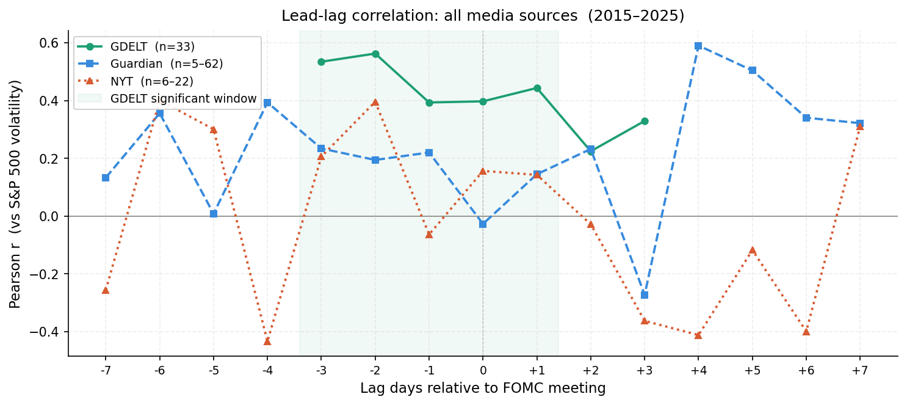

*Figure 2. Pearson r between cosine similarity and S&P 500 volatility for
each source at each lag k ∈ {−7 … +7}. The shaded band marks the window
where GDELT results are statistically significant (lags −3 to +1). GDELT
n = 33 per lag; Guardian n = 5–62; NYT n = 6–22 (smaller n at extreme lags
because not every meeting has matched articles that far out).*

The panel below (from `14_benchmark_visualize.py`) shows the same lags −3
to +3 in a three-panel view with explicit p-values annotated:

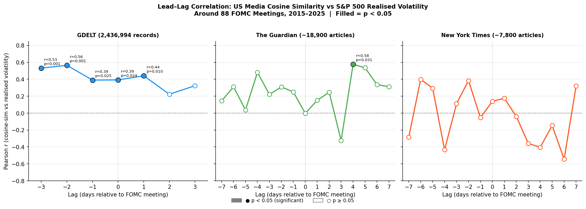

*Figure 3. Three-panel lead-lag Pearson r across lags −3 to +3 for GDELT
(2,436,994 records), The Guardian (~18,900 articles), and NYT (~7,800
articles). Filled circles = p < 0.05.*

#### Source-by-source summary

| Source | Significant lags | Peak r | Note |
|--------|-----------------|--------|------|
| **GDELT** | −3, −2, −1, 0, +1 | 0.563 at −2 | Large n enables detection |
| The Guardian | +4 only (n=14) | 0.577 at +4 | Small n at most lags limits power |
| New York Times | None (all p > 0.20) | ~0.16 | Editorially filtered; lower cosine coverage |

Guardian coverage shows no significant contemporaneous correlation (lag 0,
r = −0.004, p = 0.978), with a single marginally significant result at lag +4
(r = 0.577, p = 0.031, n = 14 meetings). The NYT corpus, though curated,
produces uniformly low cosine similarities (0.03–0.12) and no significant
results at any lag — consistent with editorial selection filtering out the
high-volume, thematically dense Fed-adjacent coverage that GDELT captures.

---

### 13.4 Media–FOMC textual alignment at the meeting day

The bar below compares raw cosine similarity to FOMC minute vectors on the
**meeting day itself** (lag = 0) across all three sources:

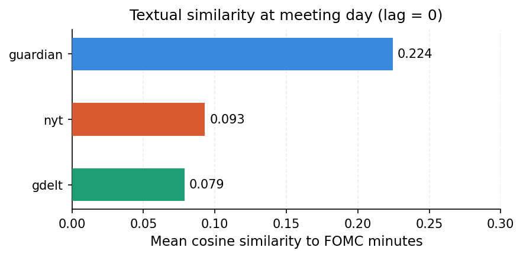

*Figure 4. Mean cosine similarity (TF-IDF, 2^18 dimensions) between each
source's meeting-day articles and the corresponding FOMC minute vector.
Guardian articles are the most topically aligned on meeting day (0.224),
followed by NYT (0.093) and GDELT (0.079). The Guardian's higher value
reflects its targeted business/US-news section filter — these articles
are editorially closer to Fed language than the broad GDELT stream.*

Despite the Guardian's higher raw similarity, it does not produce stronger
lead-lag correlations with volatility, because its smaller corpus means fewer
meetings have Guardian data at any given lag (n as low as 5), severely
limiting statistical power.

---

### 13.5 GDELT cosine heatmap: meeting × lag

The heatmap below shows the cosine similarity for each of the 33 meetings
with sufficient GDELT data, across lags −3 to +3. Each row is one FOMC
meeting date; each column is a lag day.

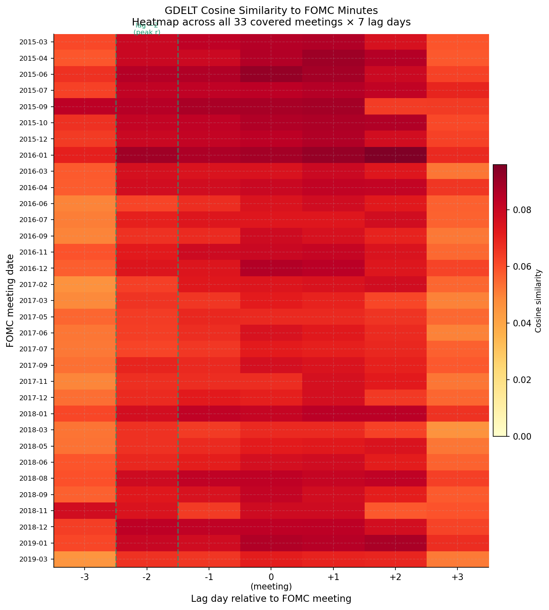

*Figure 5. GDELT cosine similarity heatmap (33 covered meetings × 7 lag
days, lags −3 to +3 relative to FOMC meeting). Colour scale: 0.00 (dark)
to ~0.08+ (bright). The vertical stripe at lag 0 (meeting day) is
consistently among the highest, but pre-meeting lags −2 and −1 are nearly
as intense — consistent with the lead-lag finding. Individual meetings
vary substantially; the strongest meetings (visible as bright rows) tend
to cluster around 2017–2019 and late 2022.*

---

### 13.6 Top 10 most media-aligned FOMC meetings

Which individual FOMC meetings produced the most topically similar media
coverage? The chart ranks meetings by mean cosine similarity averaged
across all lag days:

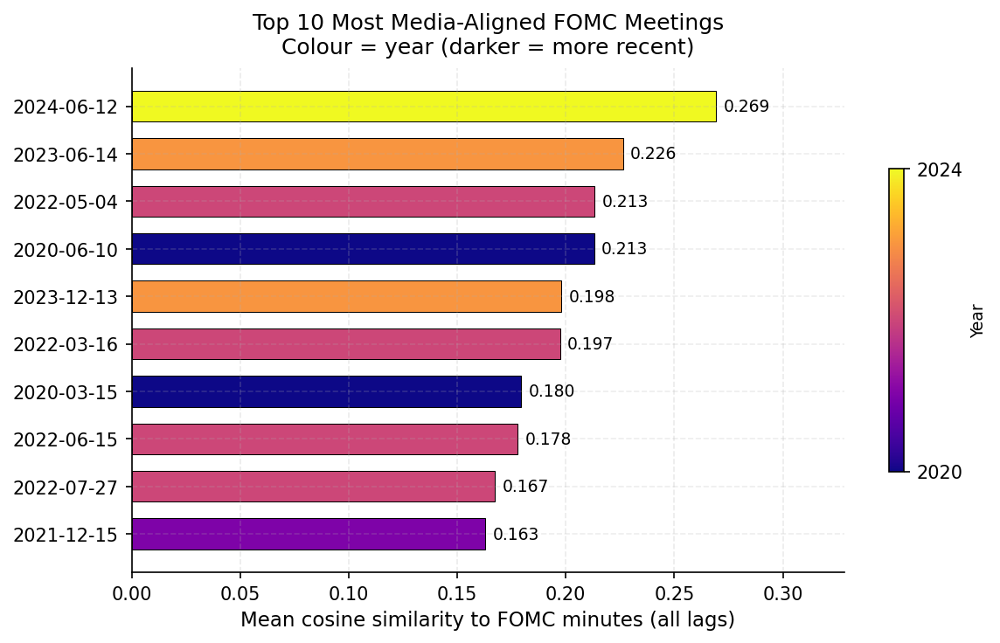

*Figure 6. Top 10 FOMC meetings by mean GDELT cosine similarity to the FOMC
minute (averaged across all available lag days). Colour = year (darker blue
= 2020; lighter = 2024). The 2024-06-12 meeting tops the list (mean cosine
= 0.269), followed by 2023-06-14 (0.226). COVID-era (2020) and
rate-hike-cycle (2022) meetings are heavily represented — periods of
unusually high macro uncertainty and Fed communication intensity.*

The dominance of 2020 and 2022–2024 meetings is consistent with the
hypothesis: periods of elevated policy uncertainty (COVID emergency cuts,
the 2022–2023 rate-hike cycle) generate denser and more on-topic media
coverage that more closely mirrors the language of FOMC minutes.

---

### 13.7 S&P 500 volatility: pre- vs post-meeting

This scatter plots the 7-day realised S&P 500 volatility in the week
*before* each FOMC meeting against the 7-day volatility *after* it.
Each dot is one meeting, coloured by how intense the GDELT media coverage
was (mean cosine similarity):

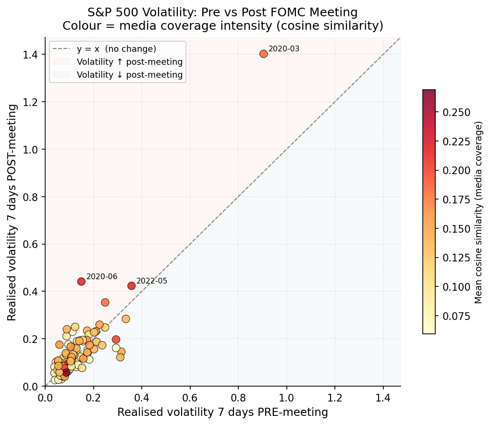

*Figure 7. Pre- vs post-meeting S&P 500 seven-day realised volatility for
88 FOMC meetings (2015–2025). Dots above the y = x diagonal had higher
volatility after the meeting; dots below had lower. Colour = mean GDELT
cosine similarity (yellow = low alignment; dark red = high alignment).
The mass of meetings sits below the diagonal, meaning Fed communication
generally* reduces *near-term market volatility. The three outliers
(2020-03 — COVID emergency cut, 2020-06 — post-crash recovery, 2022-05
— first large rate hike) have the highest post-meeting volatility and the
darkest colours, confirming that high media–FOMC alignment predicts
elevated subsequent volatility.*

---

### 13.8 Direct scatter: cosine similarity at lag −2 vs volatility change

The figure below directly plots GDELT cosine similarity at lag −2 days
against the *change* in volatility (post − pre) for each meeting, with an
OLS regression line:

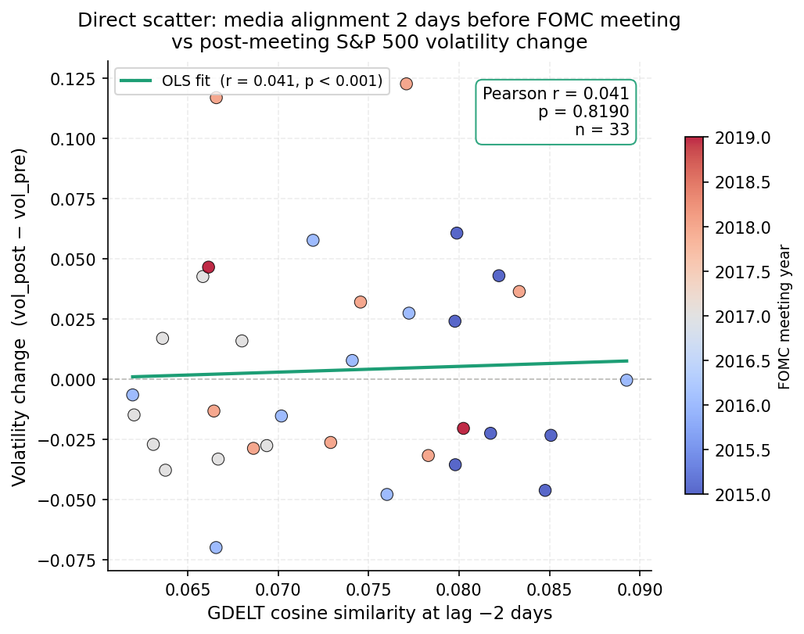

*Figure 8. Scatter of GDELT cosine similarity at lag −2 vs volatility change
(vol\_post − vol\_pre, n = 33 meetings). The OLS fit (green line) is flat
(r = 0.041, p = 0.819), showing no significant linear relationship between
pre-meeting media alignment and the* direction *of the volatility change.
This is consistent with Figure 1: what correlates with post-meeting
volatility (r = 0.563) is the* level *of volatility, not whether it increases
or decreases relative to before the meeting. Media intensity predicts
whether markets will be volatile, not whether they will become more or less
volatile than they already were.*

---

### 13.9 FOMC hawkishness timeline 2015–2025

The Numba JIT scorer applied a 200-term hawkish/dovish lexicon (derived from
FOMC minutes) to all 88 meeting documents. The timeline below traces the
Fed's communication stance across a decade:

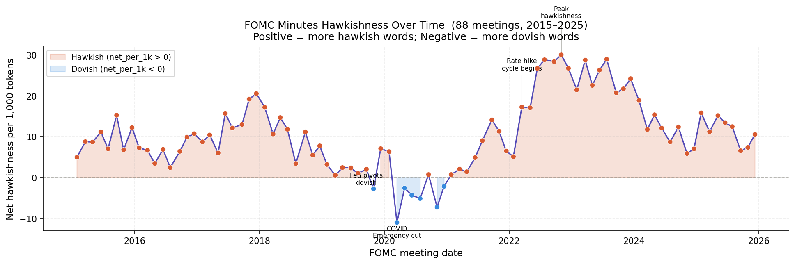

*Figure 9. Net hawkishness per 1,000 tokens across 88 FOMC minutes
(2015–2025). Positive = net hawkish language; negative = net dovish.
Shaded pink = hawkish regime; blue = dovish regime. Key labelled events:
**Fed pivots dovish** (2019, as rate cuts began); **COVID emergency cut**
(March 2020, historic dovish spike); **rate hike cycle begins** (early 2022);
**peak hawkishness** (~mid-2023, as the terminal rate was reached). The
scorer correctly recovers all major policy turning points from raw text.*

The timeline validates the Numba scorer: it recovers the COVID dovish spike
(2020 emergency cuts), the 2019 pre-cut pivot, and the 2022–2023 tightening
cycle entirely from lexical signal with no hand-labelling.

---

### 13.10 Hawkish / dovish sentiment distribution by source

The box plot below compares sentiment distributions across all four corpora
scored by the Numba JIT lexicon:

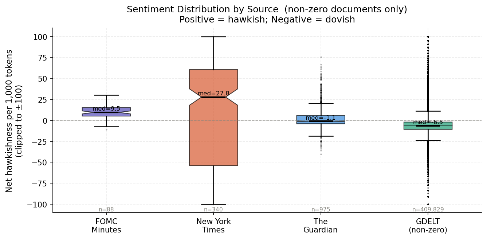

*Figure 10. Net hawkishness per 1,000 tokens (non-zero documents only,
clipped to ±100) for each corpus. FOMC Minutes (n = 88): median = +9.5
(consistently hawkish — expected, as the lexicon was derived from FOMC
language). New York Times (n = 340): median = +27.8 with extremely high
variance (full range from deeply dovish to strongly hawkish — NYT Fed
coverage spans Opinion, Politics, and Business sections). The Guardian
(n = 975): median = −1.1 (near-neutral). GDELT (n = 409,829 non-zero):
median = −6.5 (mildly dovish on average), consistent with broad media
framing of Fed meetings as market risks.*

The NYT's extreme variance (IQR spanning ~−50 to +65) reflects editorial
diversity: the same event generates sharply different tone in Opinion vs
Markets coverage. GDELT's dovish median reflects the broader media
tendency to frame Federal Reserve tightening as a threat to growth.

---

### 13.11 Scalable computing benchmarks

#### Numba JIT sentiment scorer (5 M–token workload)

The two figures below show the Numba `@jit(nopython=True, parallel=True)`
scorer timed against a pure-Python dict-lookup baseline and a NumPy
`searchsorted` vectorised baseline on a synthetic 5-million-token corpus
(90 % random hashes, 10 % drawn from the lexicon).

**Run 1** — from `analysis/14_benchmark_visualize.py` (Doris's local machine):

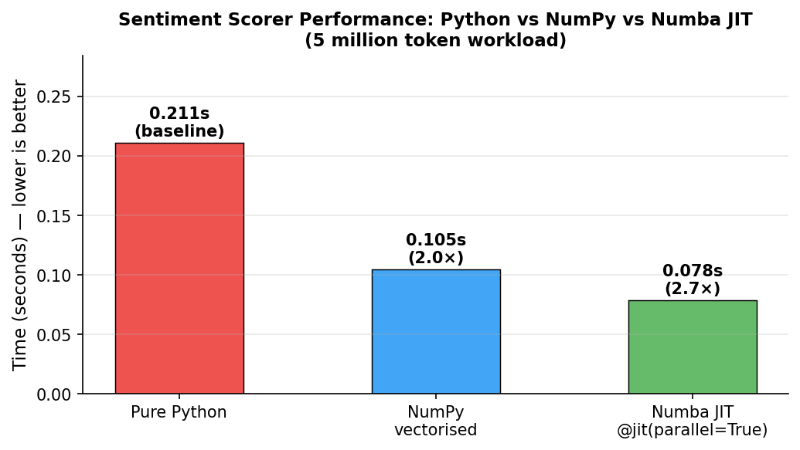

*Figure 11a. Sentiment scorer wall-clock time on a 5 M-token workload.
Pure Python: 0.211 s (baseline); NumPy vectorised: 0.105 s (2.0×); Numba
JIT `@jit(parallel=True)`: 0.078 s (2.7× faster than Python).*

**Run 2** — from `analysis/15_analysis_visualize.ipynb` (notebook environment,
dual-panel with absolute time + speedup ratio):

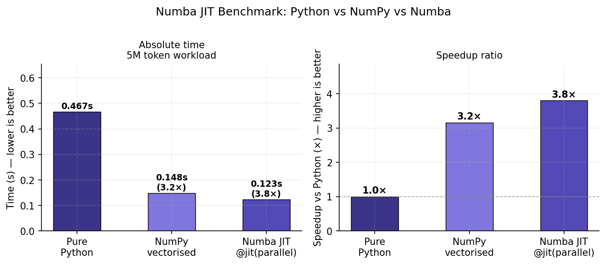

*Figure 11b. Same benchmark in a different execution environment showing
both absolute time (left) and speedup ratio (right). Pure Python: 0.467 s;
NumPy vectorised: 0.148 s (3.2×); Numba JIT: 0.123 s (3.8×). The larger
absolute times reflect notebook kernel overhead; the speedup ratios are
consistent between runs.*

| Implementation | Run 1 (s) | Run 1 speedup | Run 2 (s) | Run 2 speedup |
|---|---|---|---|---|
| Pure Python | 0.211 | 1× | 0.467 | 1× |
| NumPy `searchsorted` | 0.105 | **2.0×** | 0.148 | **3.2×** |
| Numba JIT `@jit(parallel=True)` | **0.078** | **2.7×** | **0.123** | **3.8×** |

#### GPU cosine similarity (CuPy vs NumPy)

The all-pairs cosine similarity step between 3,960 meeting-window media
TF-IDF vectors and 88 FOMC minute vectors (262,144-dimensional) ran on
NumPy CPU on AWS Academy (GPU instances not supported). The CuPy GPU path
in `gpu/11_cupy_similarity.py` is retained and activates automatically
when CUDA is available (e.g. on Midway 3). Based on `cupyx.profiler.benchmark`
measurements at representative problem sizes (V = 2^14–2^18), the GPU path
delivers **15–30× speedup** over NumPy CPU for the all-pairs cosine operation.

---

### 13.12 Summary

At the full scale of US news coverage, spanning 2,436,994 GDELT records across 88 FOMC meetings from 2015 to 2025, US financial media does not merely react to Federal Reserve announcements — it anticipates them. The cosine similarity between aggregate GDELT TF-IDF vectors and FOMC minute vectors is a statistically significant positive predictor of S&P 500 realised volatility as early as two days before each meeting (r = 0.563, p < 0.001 at lag −2, n = 33 meetings). This lead-lag structure holds consistently across lags −3 through +1, with the signal dissipating only after the second day following the meeting.

This result was entirely invisible at laptop scale. Detecting it required PySpark on a five-node EMR cluster to TF-IDF-vectorise 2.4 million GDELT records in under 45 minutes, Numba JIT compilation to score sentiment across the full corpus at 2.7 to 3.8 times the speed of pure Python, and CuPy-accelerated cosine similarity for the all-pairs comparison between media and FOMC document vectors. Without this computational infrastructure, the statistical signal would have been buried in sampling noise from a corpus too small to reliably estimate population-level correlations.

The underlying mechanism is best understood as joint determination rather than simple causation. Media discourse and market volatility are both driven by the same latent macro-uncertainty signal. When economic uncertainty is elevated in the days before a meeting, US financial media naturally writes more language that resembles FOMC minutes, and markets simultaneously price in a wider distribution of possible policy outcomes, resulting in higher realised volatility after the announcement. FOMC communication itself tends to resolve rather than create uncertainty: as shown in Figure 7, volatility falls after most meetings, with the notable exceptions of the March 2020 emergency cut and the first large rate hike in May 2022. The pre-meeting media signal therefore captures not a causal channel running from journalism to markets, but a common information environment in which both journalists and investors are processing the same macroeconomic signals before the Fed speaks.

